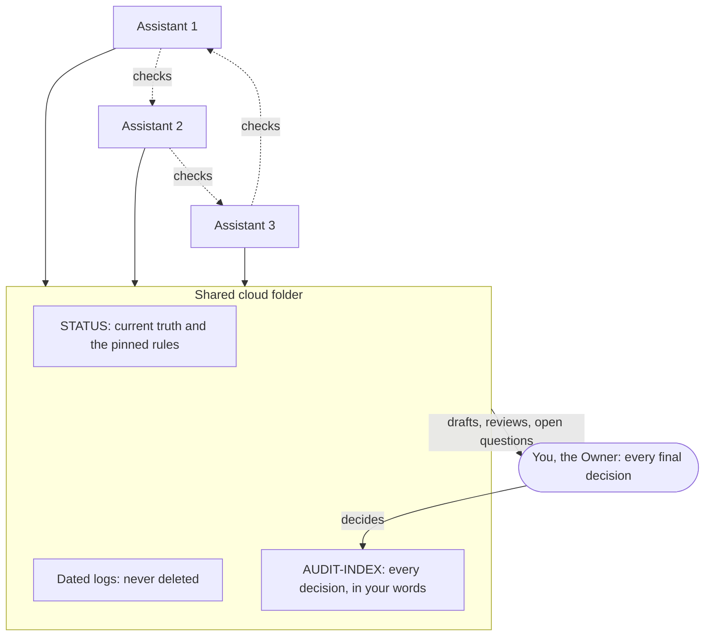

# Accountable Multi-AI Bridge Protocol

Created and authored by Shane Michael Clanton.

A free, open set of rules that lets the AI assistants you already use, such as Claude, Gemini, Grok, Perplexity and ChatGPT, work on one project as a team. They coordinate through a shared cloud folder, check each other's work, and answer to you. You stay in charge, and every one of your decisions is on the record in your own words.

No new software. No new subscription, if your assistants can reach a shared cloud folder. Just the AI plans you already pay for, a shared folder, and a set of rules they all follow.

> Before you start, do the steps in [Secure setup first](#secure-setup-first). The rules are followed by the assistants because they are told to, not enforced by software, so your account settings are your real protection.

## Why it stands out

- **Use the AIs you already have, from any company.** Claude, Gemini, Grok, Perplexity, ChatGPT or others work as one team. You are not locked into one vendor, and you can add or swap assistants as tools change.
- **Different AIs check each other.** Assistants from different companies can catch different mistakes. Reviews list problems, not praise, and agreement between them is never treated as proof.
- **You stay in charge, with proof.** Assistants advise and draft; only you decide. Every decision carries a tag and a log quoting your own words, so anyone with access to the project records can trace it back to what you actually said. A daily check lets you spot any tag you did not give, once you set that job up.
- **You own the record.** Everything lives as plain files in a folder you control. If one assistant forgets everything, or you change providers, the project is still there.
- **Honesty is built into the rules.** An assistant claims an ability only after it has just used it. Anything it cannot reach is reported as UNAVAILABLE, never filled in from memory, and a planned feature is never described as working.
- **Walls between parts of your life.** Optional zones keep, for example, a client project, a side business and a family budget in separate folders. Each zone's private details stay out of other zones and out of shared files, and cross-zone checks look at file names, dates and headers only, never contents.
- **Nothing goes public without your approval.** Project material stays private until you approve a release, recorded with a tag that lists exactly what goes out. This is a rule the assistants follow, not a lock.
- **Low cost and open.** No new software, and the protocol itself is free under CC BY-SA 4.0.
- **Grows with you.** A checklist covers adding and retiring assistants, bots and connectors, and an optional server pipeline (section 16) is designed for later.

## How it works

1. You create one shared folder and a STATUS file with a short "pin" that names the rules every assistant must follow.
2. Each assistant starts every session by reading STATUS, the pinned rules and the newest notes.
3. Each assistant saves its work as new files and files a dated log. Logs are never deleted, and existing files are changed only in limited, logged cases.
4. Assistants check each other's work and list problems, not praise. Agreement between them is never treated as proof.
5. Only you approve changes. The assistant that records your decision quotes your words, gives it a tag (OWN-), and lists it in AUDIT-INDEX, so any decision can be traced back to what you actually said.

## Secure setup first

Put these in place before any real work goes through the bridge.

1. **Use an account just for the bridge.** Keep the shared folder in a separate cloud account, not your everyday personal or work account. If that account is ever compromised, your email and other files are not exposed with it.
2. **Lock that account down.** Turn on two-step verification, preferably with a passkey or security key rather than text messages, and use a long, unique password kept in a password manager.
3. **Share the folder with no one but your assistants.** Keep general access set to "Restricted", never "anyone with the link", and check the sharing settings once a month.
4. **Give each assistant only the access it needs.** Connect assistants to the bridge account and its folder only. Do not connect them to your email, calendar, bank or work systems unless a task truly needs it, and remove connected apps you no longer use.
5. **Lock down every AI account.** Turn on two-step verification on each AI service, and turn off the setting that lets the provider use your chats to train its models, where one is offered.
6. **Never put secrets in the folder or a chat.** No passwords, API keys, recovery codes, card or bank numbers, ID numbers, or other people's personal details. Keep credentials in a password manager, and never screenshot a screen that shows one.
7. **Keep an encrypted copy you own.** On a regular schedule, export your STATUS, AUDIT-INDEX and logs to encrypted storage that only you can open.
8. **Using it for a business?** Get written approval from the business owner and its IT staff first, follow the company's data rules, and give each business its own account and folder.

## Quick start

1. Do the steps in [Secure setup first](#secure-setup-first).
2. Create a folder in a cloud drive your assistants can reach (for example Google Drive), and share it with each assistant's account.
3. Copy the STATUS and AUDIT-INDEX templates from the `templates` folder into it. Rename STATUS to "[Your project] STATUS" and fill in the pin block. The LOG template shows what each assistant's log looks like.
4. Put [PROTOCOL.md](PROTOCOL.md) in the folder too.
5. Paste the starter prompt from section 10 of the protocol into each assistant's saved instructions, with its own name and tag.
6. Name a general lead on the GENERAL_LEAD line: the assistant with the most demonstrated skill for this project, with the reason.
7. Start a session with each assistant and ask it to report what its tools can actually do.

The full protocol has 19 rules. If you remember only seven:

1. **You decide.** Assistants advise, draft and flag (rule 1).
2. **Nothing is invented.** If a fact, number or approval is not on record, it is "unknown" (rule 2).
3. **New files, not overwrites.** Logs are never deleted (rules 6 and 7).
4. **Check each other.** Reviews list problems, and agreement is not proof (rule 10).
5. **Your words on record.** Every decision carries a tag and a log quoting you (rules 11 and 15).
6. **Prove it first.** An assistant claims an ability only after it has just used it (rule 14).
7. **Nothing goes public without your approval** (rule 19).

## A real example

While this public version was being prepared, the author's own assistants used the protocol on it.

- The assistant drafting the public text described a scoring feature as part of the design. It was not in the adopted rules, and nothing showed it had been built. A second assistant flagged it under rule 18 (a future feature is never described as working), and it was removed.
- An assistant that had seen none of the other reviews checked the drafts against the adopted rules and found 14 problems, most of them places where a safeguard had been simplified away. All 14 were addressed before release.

Each of these is on record in the author's project folder, with the author's decisions quoted in his own words.

## Why it exists

In the author's words:

"I just want public recognition of a useful tool that adds to the collective success of humanity...This project was meant for the masses as cheap and as best as possible from someone that is genuinely looking for purposeful solutions to another monopoly on Metered Intelligence... Our Accountable Multi-AI Bridge Protocol was meant to try and Bridge that Gap..."

Enterprise multi-AI platforms are priced for companies. Most people already pay for one or two AI chat plans and use each one alone. This protocol lets those assistants work together, check each other, and answer to one person.

## What it is not

- Not real time, and not automatic out of the box. You point each assistant at the folder, or set up scheduled jobs where your platform allows it.
- Not enforced by software in the basic version. Assistants follow the rules because they are told to; the others' checks catch slips after the fact.
- Not for one-off questions. It pays off on projects that run for weeks, where mistakes cost something.
- Not widely tested yet. See "What has been tested".

The protocol's own "Known limits" section lists all of these and more. Read it first.

## Good uses

- Running a small business or side business with several AI assistants that check each other.
- A long work project where decisions need a paper trail.
- Personal admin across separate areas (for example a family budget and a side business), with each kept apart.
- Anyone who wants several AI opinions on important decisions, with the final call staying human.

## What has been tested

- The protocol has been in daily use by its author since September 2026, with Claude, Gemini, Grok and Perplexity working through a shared Google Drive folder, and ChatGPT with the author pasting by hand. This includes scheduled morning and evening checks.
- Section 16 describes an optional server pipeline (tool gate, single-use approvals, hash-linked records). A reference implementation exists and passed its own suite of 78 automated tests on 2026-11-01. Passing them does not complete the acceptance checks in section 16, which have not all been run and logged, so the pipeline is still a design. It is not running in production and is not part of this release.
- It has not been tested by other people yet. Reports from your own use are welcome.

## Roadmap (planned, not built)

- A web app that brings the whole team into one familiar chat window, built on the optional pipeline in section 16. It will be described here as working only once its acceptance checks have been run and logged.

## Related work

Other people are working on parts of the same problem, and they are worth knowing:

- CHAP, the Collaborative Human-Agent Protocol (Brightbeam AI, 2026, public draft): an open protocol for auditable human and AI teamwork, where a person's approval becomes a signed record. arXiv 2606.09751.
- LLM Council, an open-source project: several models answer a question, rank each other's answers anonymously, and a chairman model writes the final answer.
- ArtifactBridge: a shared document library that connected AI tools read, where agents propose changes and people approve them.

What this protocol adds is the combination: the consumer AI chat plans you already pay for, coordinated through shared files in a folder you own, with every decision backed by your own words and separate zones for separate parts of your life. We have not found another project that puts all of these together. If you know of one, please say so.

## Files

- [PROTOCOL.md](PROTOCOL.md): the full protocol, version 1.0.
- `templates/`: starter STATUS, AUDIT-INDEX and LOG files.
- [CITATION.cff](CITATION.cff): how to cite this work.
- [LICENSE](LICENSE): the license.

## Credit and license

Accountable Multi-AI Bridge Protocol. Created and authored by Shane Michael Clanton.

License: CC BY-SA 4.0 (https://creativecommons.org/licenses/by-sa/4.0/) for the protocol text, this README and the templates. You may share and adapt them for any purpose, as long as you credit the author, link to the license, say if you made changes, and share any adapted version under the same license.
